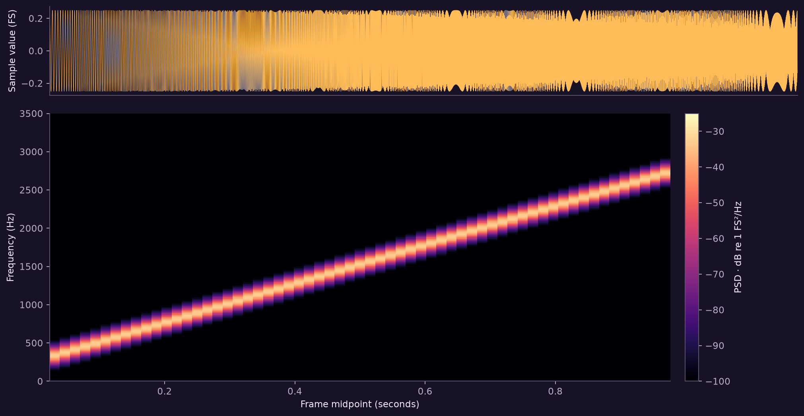

# Signal spectrum lab

**[View the report in your browser](https://Michaelhoang8.github.io/signal-spectrum-lab/)**

A radix-2 complex FFT implemented from source, with calibrated amplitude spectra, power spectral density and a short-time Fourier transform. Nine synthetic mono PCM16 WAV fixtures are committed and decoded before analysis. The repository preserves 22 full spectra, 61 chirp STFT frames, reference comparisons and 56 actual timing observations.

[Technical report](docs/report.html) · [Chirp replay with audio](docs/media/chirp-replay.mp4) · [Formulae and units](docs/formulae.md) · [Methodology](docs/methodology.md) · [Findings](docs/findings.md) · [Audio fixtures](results/published/audio) · [Screenshots](docs/screenshots/README.md) · [Report recording](docs/recordings/README.md)



## Engineering work

- Iterative radix-2 butterflies and bit-reversal ordering, with a matching inverse transform.
- Periodic Hann and rectangular windows, coherent-gain amplitude correction and equivalent noise bandwidth.
- Correct one-sided DC/Nyquist handling and PSD integration in digital full-scale units.
- Complete-frame STFT with explicit hop, timestamp and tail policies.
- PCM16 serialization, quantization checks and analysis of actual decoded file bytes.
- Independent direct-DFT and NumPy comparisons, analytic calibration tests and artifact reconciliation.
- Preserved examples of window leakage, close-tone separation, zero-padding and sampling aliasing.

The FFT, spectrum, STFT and WAV code use only the standard library. NumPy provides an external numerical reference and Matplotlib renders the report; neither implements the project's transform.

## Reproduce

Python 3.11 or newer is required. The preserved execution and CI use Python 3.13.

```sh
python -m pip install -e . -r requirements.txt
python -m unittest discover -s tests -v
python scripts/run_study.py --out outputs/my-run
```

Fresh studies write a separate directory and refuse to overwrite a nonempty one. To reconcile a fresh run:

```sh
# POSIX shell
SPECTRUM_RESULTS=outputs/my-run python -m unittest discover -s tests -v
```

```powershell
# PowerShell
$env:SPECTRUM_RESULTS = 'outputs/my-run'
python -m unittest discover -s tests -v
Remove-Item Env:SPECTRUM_RESULTS
```

To rebuild figures and the offline report from the preserved results:

```sh
python scripts/build_report.py
```

Open `docs/report.html` in a browser, or serve the repository with `python -m http.server 8080`. Audio controls never autoplay. Files have decoded sample peaks no larger than 0.3 digital full scale; this numerical bound is not an acoustic sound-level calibration.

The six-second [chirp replay](docs/media/chirp-replay.mp4) plays four exact one-second PCM repeats at original speed, with one silent second before and after, while a cursor crosses the stored STFT. This is saved-analysis playback, not live processing. Rebuild it with `python scripts/render_replay.py`; that optional command requires ffmpeg/libx264/AAC on `PATH`. The MP4 preview resamples to 48 kHz and encodes AAC. The original 8192 Hz PCM WAV remains the analysis authority. [Replay metadata](docs/media/replay.json) records input/output hashes, versions and the measured decoded preview peak.

## Analyze a WAV through the API

```python
from spectrumlab.audio import read_pcm16
from spectrumlab import spectrum, stft

samples, sample_rate = read_pcm16("results/published/audio/coherent.wav")
result = spectrum(samples, sample_rate, window_name="hann")
peak = max(range(len(result.amplitude)), key=result.amplitude.__getitem__)
print(result.frequencies[peak], result.amplitude[peak])
print(result.psd_integral, result.weighted_mean_square)
```

`read_pcm16` supports uncompressed mono PCM16. `spectrum` accepts finite real samples, uses a power-of-two FFT size at least as long as the observation, and returns amplitude in sample units and PSD in sample-unit²/Hz. A larger `nfft` pads with zeros; it does not add observed data.

## Results to inspect

| Example | Observation |
| --- | --- |
| Off-bin 513.3 Hz tone | Power beyond ±8 Hz is 2.525% with a rectangular window and 0.00138% with periodic Hann, using the specified 0.5 Hz analysis grid. Hann broadens the main lobe. |
| 1000/1010 Hz tones | A 62.5 ms observation remains unresolved after zero-padding; a 500 ms observation separates the peaks in this example. |
| Calibration mixture | DC, a coherent tone and Nyquist retain their specified endpoint/interior amplitude conventions after PCM quantization. |
| Sampling alias | The 6144 Hz and 2048 Hz cosine fixtures produce byte-identical WAV files at 8192 samples/s. |
| Transform reference | The largest recorded absolute difference from NumPy is about 2.39 × 10⁻¹⁴ on the four decoded-chirp prefix cases. |

The timing report compares complete Python FFT calls with NumPy's native implementation. It makes no real-time or general performance claim. Coherent-gain correction does not make every off-bin or overlapping peak an accurate component-amplitude estimate. The [formulae](docs/formulae.md) define all units and caveats.

## Evidence layout

The 13-test suite combines independent direct DFT and NumPy comparisons with analytic transform identities, odd-length Hann calibration, endpoint and PSD tests, malformed WAV rejection and complete artifact reconciliation. The replay video, its source inputs, report screenshots and browser recording are also hash-checked.

```text
src/spectrumlab/          transform, calibration, framing, PCM and generators
tests/                   numerical, analytic, WAV and evidence checks
scripts/                 study execution and report rendering
results/published/audio/ committed synthetic WAV bytes
results/published/spectra/ complete calibrated spectral CSVs
results/published/       STFT, peaks, comparisons, timings and hashes
docs/                    formulae, methodology, findings, plots and report
outputs/                 ignored fresh reproductions
```

This AI-assisted engineering study uses only owned synthetic signals. It contains no music, speech recordings, external audio assets, sensor measurements, acoustic calibration or production DSP deployment claim.
